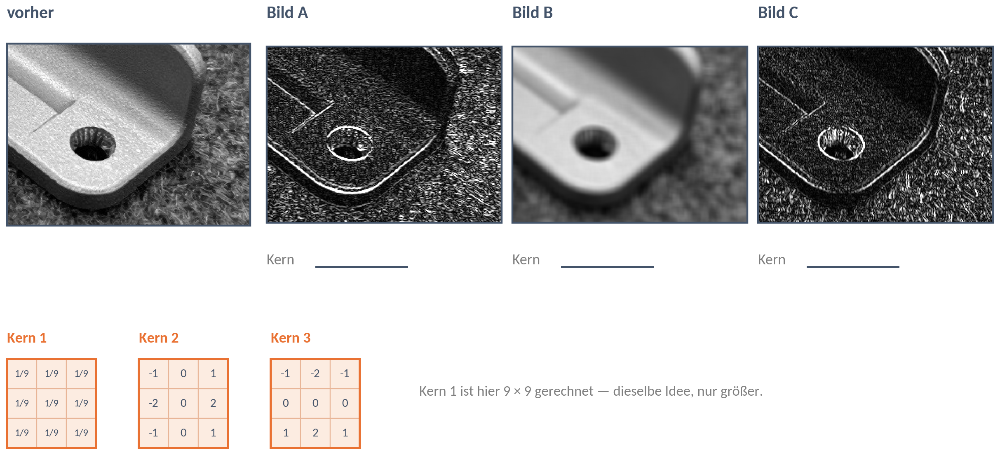

# DS 05 — Arbeitsblatt

**Faltung und Filter: Was die Nachbarn verraten · 20.10.2026**

Ein neues Skript im Ordner eurer vier Aufnahmen aus DS 03. Welche Befehle ihr braucht, entscheidet ihr selbst — sie stehen im Werkzeugkasten. Wer festhängt, klappt unter dem Auftrag den nächsten Tipp auf.

**Zuerst:** Macht im Arbeitsblatt der DS 04 die Aufträge P2 und P3 fertig — im Skript aus der letzten Stunde. Danach geht es hier weiter.

---

## E — Erfindet eine Rechnung (etwa 8 min, im Heft)

**Ziel:** Eine Rechnung aus neun Zahlen, die an einer Kante eine **große** Zahl ergibt und auf einer gleichmäßigen Fläche **0** — egal, wie hell die Fläche ist.

**Auftrag:** Erst allein (2 Minuten), dann zu zweit. Rechnet eure Rechnung an beiden Feldern aus.

```
am Verlauf              auf der Fläche
10   20   30            50   50   50
40   50   60            50   50   50
70   80   90            50   50   50
```

**Tipps** — erst selbst probieren, dann immer nur den nächsten aufklappen.

<details><summary>Tipp 1 — Was ist am Verlauf anders?</summary>

Schaut, wie sich die Zahlen am Verlauf von links nach rechts ändern — und von oben nach unten. Auf der Fläche ändert sich nichts.

</details>

<details><summary>Tipp 2 — Wie wird die Fläche 0?</summary>

Auf der Fläche sind alle neun Zahlen gleich. Was muss man mit gleichen Zahlen machen, damit 0 herauskommt — ganz egal, ob es 50 oder 120 sind?

</details>

<details><summary>Tipp 3 — Ein Ansatz</summary>

Nehmt eine Seite des Feldes und zieht die gegenüberliegende Seite ab. Rechnet es an beiden Feldern aus.

</details>

Unsere Rechnung in Worten:

Ergebnis am Verlauf: … Ergebnis auf der Fläche:

Gilt sie auch für eine Fläche aus lauter 120?

---

## P2 — Ein Kantenbild mit allen Kanten (etwa 15 min)

**Ziel:** Ein Kantenbild von `misch`, in dem **alle** Kanten eures Bauteils hell sind — egal, in welche Richtung sie laufen und ob es dort heller oder dunkler wird.

**Auftrag 1:** Schreibt eure erfundene Rechnung aus E als Kern *K* — neun Gewichte, Zeile für Zeile — und prüft sie am Rechner an beiden Feldern aus E. Prüft genauso Sobel-x (die 80 von der Folie).

| Kern | Verlauf | Fläche (E) | Gewichtssumme |
|---|---|---|---|
| eure Erfindung | | | |
| Sobel-x | 80 | | |

**Tipps** — erst selbst probieren, dann immer nur den nächsten aufklappen.

<details><summary>Tipp 1 — Welche Werkzeuge?</summary>

„Einen Kern schreiben" und „Falten". Eure Rechnung aus E wird zum Kern: Jede der neun Zahlen bekommt ein Gewicht — +1, wenn sie zählt, −1, wenn sie abgezogen wird, 0, wenn sie nicht vorkommt.

</details>

<details><summary>Tipp 2 — Eine Stelle, dann das ganze Bild</summary>

An einer Stelle faltet `(feld * kern).sum()`. Für das ganze Bild nehmt ihr `cv2.filter2D` mit demselben Kern und schaut im Ergebnis an **derselben** Stelle nach: Dort muss dieselbe Zahl stehen.

</details>

**Auftrag 2:** Faltet das **ganze** Bild `misch` und baut daraus ein Kantenbild mit allen Kanten. Sobel-x allein reicht dafür nicht.

**Tipps zu Auftrag 2**

<details><summary>Tipp 3 — Welche Kanten fehlen?</summary>

Zeigt das Ergebnis von Sobel-x an. Welche Kanten eures Bauteils sind hell — und welche fehlen? Sobel-x rechnet rechts minus links. Welche Rechnung bräuchtet ihr für die fehlenden?

</details>

<details><summary>Tipp 4 — Der zweite Kern</summary>

Dreht Sobel-x um eine Vierteldrehung: Aus „rechts minus links" wird „unten minus oben". Die Zahlen −1, −2, −1 stehen dann in der obersten Zeile, 1, 2, 1 in der untersten.

</details>

<details><summary>Tipp 5 — Dunkle Kanten und zwei Bilder</summary>

Wo es nach rechts dunkler wird, kommen Minuszahlen heraus — die zeigt `plt.imshow` schwarz. Macht sie erst positiv, dann zählt die beiden Kantenbilder zusammen.

</details>

Was habt ihr dazu gebaut, und warum?

Mittelwert eures Kantenbilds:

---

## P3 — Der Härtetest: Hält euer Kantenbild jedes Licht aus? (wer fertig ist)

**Ziel:** Der Umriss eures Bauteils ist bei jeder Beleuchtung zu sehen — auch dort, wo Otsu in DS 04 gekippt ist.

**Auftrag 1:** Erst vermuten: Was passiert mit dem Kantenbild, wenn `misch` vorher um 60 heller ist? Und wenn es mit 2 malgenommen ist?

Unsere Vermutung:

**Tipps** — erst selbst probieren, dann immer nur den nächsten aufklappen.

<details><summary>Tipp 1 — Plus und mal</summary>

Rechnet die Gewichtssumme von Sobel-x aus. Was passiert mit dem Ergebnis, wenn zu allen neun Zahlen 60 dazukommt? Und wenn alle neun doppelt so groß sind?

</details>

| | Mittelwert des Kantenbilds |
|---|---|
| `misch` | |
| `misch + 60.0` | |
| `misch * 2.0` | |

Begründet mit der Gewichtssumme:

**Auftrag 2:** Rechnet das Kantenbild aller vier Aufnahmen. Stört der Filz, glättet vorher. Tragt euer Ergebnis in die Tabelle an der Tafel ein.

**Tipps zu Auftrag 2**

<details><summary>Tipp 2 — Vier Aufnahmen</summary>

In der Schleife muss jede Aufnahme genauso vorbereitet werden wie `misch`: Graustufen, derselbe Ausschnitt. Danach dieselben Zeilen wie für euer Kantenbild, mit dem Namen aus der Schleife.

</details>

<details><summary>Tipp 3 — Der Filz stört</summary>

Glätten nimmt die kleinen Unterschiede weg, die großen bleiben. Faltet das Bild erst mit einem Mittelwertkern (zum Beispiel 9 × 9) und dann mit euren Kantenkernen.

</details>

| Aufnahme | Otsu in DS 04 | Mittelwert des Kantenbilds | Umriss zu sehen? |
|---|---|---|---|
| `hell` | gekippt | | |
| `seitlich` | gekippt | | |
| `misch` | brauchbar | | |
| `dunkel` | brauchbar | | |

**Kür:** Baut für `seitlich` eine Maske, in der jeder Pixel seine **eigene** Schwelle hat: die Helligkeit seiner Umgebung. Vergleicht mit der Otsu-Maske aus DS 04.

**Tipp zur Kür**

<details><summary>Tipp 4 — Kür: die eigene Schwelle</summary>

„Die Helligkeit der Umgebung" ist ein geglättetes Bild — mit einem sehr großen Kern, größer als euer Bauteil breit ist (etwa 151 × 151). Weiß soll werden, wer heller ist als **seine** Stelle im geglätteten Bild: Das ist ein Vergleich zweier Bilder. Ohne Abstand zerfällt der Untergrund — probiert, wie viel heller ein Pixel sein muss (etwa 10 bis 40).

</details>

Unsere Umgebung: … × … Anteil weiß: … %

---

## P4 — Prüfungsformat: Welcher Kern war es? (wer fertig ist)

> Drei Kerne wurden auf denselben Ausschnitt angewendet. Die Bilder A, B und C zeigen das Ergebnis.



a) Ordnet jedem Bild seinen Kern zu und begründet mit **einem** Merkmal des Bildes.

   Bild A → Kern … weil

   Bild B → Kern … weil

   Bild C → Kern … weil

b) Bestimmt die Gewichtssumme von Kern 1 und Kern 2. Was sagt sie darüber, wie eine gleichmäßige Fläche nach der Faltung aussieht?

c) Rechnet Kern 3 an der Stelle vom Aufwärmen (die Nachbarschaft 10 bis 90).

---

## Wer noch Zeit hat

- Faltet `misch` mit dem Schärfen-Kern aus dem Werkzeugkasten. Seine Gewichtssumme ist 1 wie beim Mittelwert. Was macht er trotzdem anders? Belegt es mit einer Zahl.
- Eure Maske aus der Kür hat Flecken im Untergrund. Bekommt ihr weniger davon?

**Tipps** — erst selbst probieren, dann immer nur den nächsten aufklappen.

<details><summary>Schärfen</summary>

Vergleicht Mittelwert und Streuung vorher und nachher. Was bleibt gleich, was nicht — und was sagt das über die Gewichtssumme 1?

</details>
