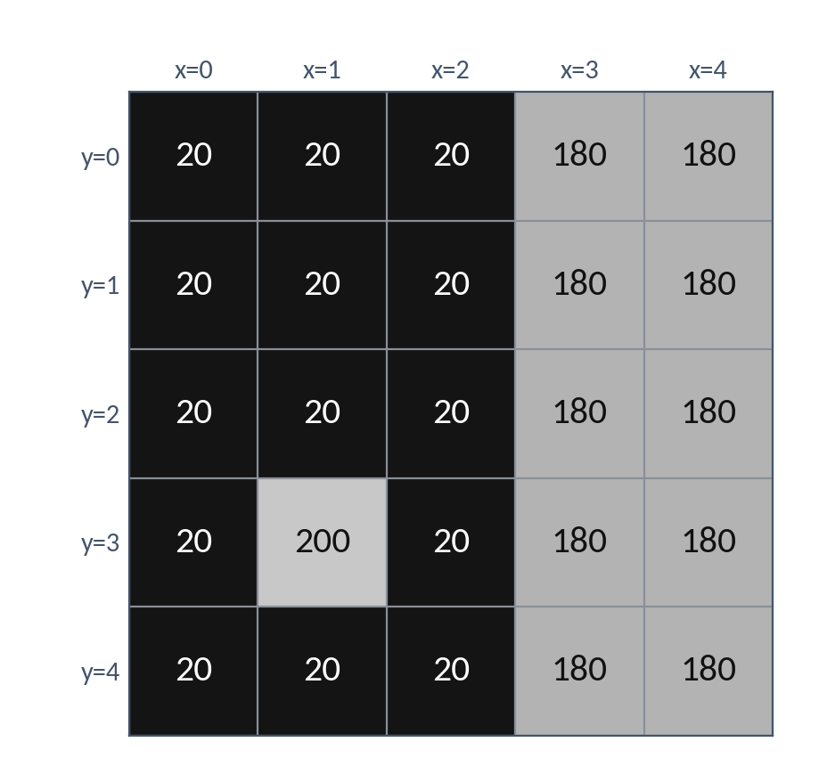
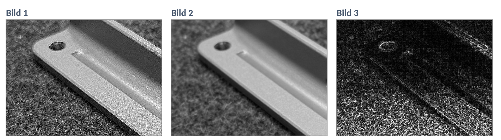

# DS 05 — Hausaufgabe

**Faltung und Filter: Was die Nachbarn verraten · bis Di, 27.10.2026**

---

## Der Rand eines Bauteils

Ein Ausschnitt von 5 × 5 Pixeln: links dunkler Untergrund, rechts das helle Bauteil. Bei (y=3, x=1) liegt ein Reflex im Untergrund.



Die beiden Kerne aus dem Unterricht:

```
Sobel-x            Mittelwert

-1   0   1         1/9  1/9  1/9
-2   0   2         1/9  1/9  1/9
-1   0   1         1/9  1/9  1/9
```

a) Rechnet Sobel-x an der Stelle **(y=1, x=2)**. Schreibt den Rechenweg Zeile für Zeile auf.

Ergebnis:

b) Rechnet Sobel-x an der Stelle **(y=1, x=1)**.

Ergebnis:

Die Pixel dort sind nicht schwarz — warum kommt trotzdem dieses Ergebnis heraus? Ein Satz mit dem Wort **Gewichtssumme**.

c) Rechnet den Mittelwert an der Stelle **(y=3, x=1)**, genau über dem Reflex.

Summe: … Ergebnis:

Ist der Reflex nach dem Glätten verschwunden? Was ist aus ihm geworden?

---

## Drei Kerne, drei Bilder

Drei weitere Kerne:

```
Kern P                   Kern Q              Kern R

1/16  2/16  1/16          0   1   0           0  -1   0
2/16  4/16  2/16          1  -4   1          -1   5  -1
1/16  2/16  1/16          0   1   0           0  -1   0
```

Jeder Kern wurde auf denselben Ausschnitt eines Halters angewendet:



d) Bestimmt die Gewichtssumme jedes Kerns.

P: … Q: … R:

e) Ordnet jedem Bild seinen Kern zu. Begründet jeweils mit dem, was ihr im Bild seht.

Bild 1 → Kern … weil

Bild 2 → Kern … weil

Bild 3 → Kern … weil
