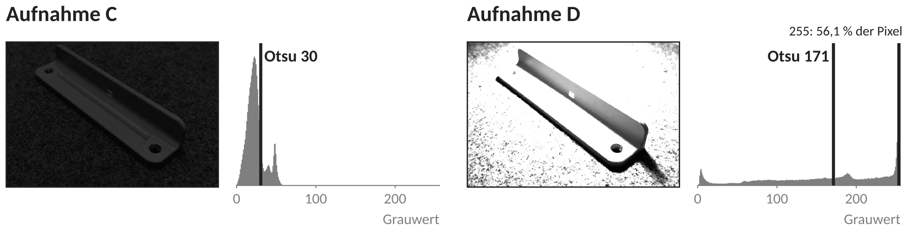
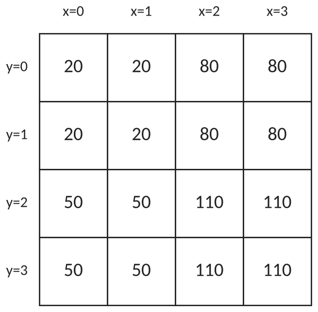

# Übung zur Kurzarbeit — Computer Vision

**Kurzarbeit am Di, 10.11.2026** · 20 Minuten · Taschenrechner erlaubt · kein Rechner, kein Handy

Die Kurzarbeit hat genau diese drei Aufgabentypen — mit anderen Aufnahmen und anderen Zahlen. Rechnen Sie die Übung auf Papier, mit Rechenweg und Begründung, und nehmen Sie sich dafür 20 Minuten. Erst danach die Lösungen am Ende aufklappen.

---

## Aufgabe 1 — Die Nachtschicht retten (9 P)

Eine Prüfstation hat nachts eine zu dunkle Aufnahme *A* gemacht. Am Tag sehen die Aufnahmen derselben Halterung so aus:

| | Mittelwert | Streuung |
|---|---|---|
| Aufnahme *A* (nachts) | 40,2 | 14,8 |
| Aufnahme am Tag (das Ziel) | 125,0 | 45,0 |

a) Die Aufnahme *A* soll mit einer Punktoperation *B* = *c* · *A* + *d* denselben Mittelwert und dieselbe Streuung bekommen wie die Aufnahme am Tag. Bestimmen Sie *c* und *d* (auf ganze Zahlen gerundet) und begründen Sie, welcher der beiden Werte die Streuung festlegt. **(3 P)**

*c* = … *d* =

b) Drei Pixel der Aufnahme *A* haben die Grauwerte 10, 25 und 60. Berechnen Sie ihre Werte nach der Punktoperation *B* = 3 · *A* + 4. **(2 P)**

10 → … 25 → … 60 →

c) Otsu findet für die Aufnahme *A* die Schwelle 35. Welchen Wert hat ein Pixel mit dem Grauwert 35 in *B* = 3 · *A* + 4? Mit welcher Schwelle erhält man in *B* genau dieselbe Maske? Begründen Sie in einem Satz. **(2 P)**

35 → … Schwelle in *B*:

d) Ein Team nimmt stattdessen *B* = 6 · *A* + 4 und speichert das Ergebnis als 8-Bit-Bild. Welchen Wert hat der Pixel mit dem Grauwert 60 danach? Ab welchem Grauwert von *A* landen alle Pixel auf demselben Wert — und warum lässt sich das nicht mehr rückgängig machen? **(2 P)**

---

## Aufgabe 2 — Eine Schwelle für das ganze Bild (6 P)



a) Bei welcher der beiden Aufnahmen liefert Otsu eine brauchbare Maske (Bauteil weiß, Untergrund schwarz)? Begründen Sie mit dem Histogramm. **(2 P)**

b) Am Nachmittag fällt die Sonne quer über ein Prüfband. In einer Aufnahme sind vier Pixel gemessen:

| Pixel | liegt auf … | Grauwert |
|---|---|---|
| 1 | Bauteil im Licht | 230 |
| 2 | Untergrund im Licht | 180 |
| 3 | Bauteil im Schatten | 90 |
| 4 | Untergrund im Schatten | 40 |

Zeigen Sie, dass es **keine** Schwelle gibt, bei der beide Bauteil-Pixel weiß und beide Untergrund-Pixel schwarz werden. **(2 P)**

c) Ein Team bearbeitet die Aufnahme vorher mit der Punktoperation neu = 0,5 · alt + 100. Berechnen Sie die vier Pixel neu. Gibt es jetzt eine Schwelle? Begründen Sie, warum das für jede Punktoperation neu = *c* · alt + *d* mit *c* > 0 so ist. **(2 P)**

1 → … 2 → … 3 → … 4 →

---

## Aufgabe 3 — Faltung (9 P)

Gegeben ist dieser Bildausschnitt:



a) Berechnen Sie den neuen Wert an der Position **(y=1, x=1)** für den Mittelwertkern. Rechenweg angeben. **(3 P)**

```
1/9  1/9  1/9
1/9  1/9  1/9
1/9  1/9  1/9
```

Ergebnis:

b) Berechnen Sie den neuen Wert an derselben Position für den Kern Sobel-x. Rechenweg Zeile für Zeile angeben. **(4 P)**

```
-1   0   1
-2   0   2
-1   0   1
```

Ergebnis:

c) Welche Gewichtssumme hat Sobel-x? Das ganze Bild wird nun **mit 2 multipliziert**. Was wird aus Ihren Ergebnissen in a) und b)? Begründen Sie. **(2 P)**

---

## Lösungen — erst selbst rechnen

<details><summary>Lösung Aufgabe 1</summary>

**a)** Die Streuung legt nur *c* fest — *d* verschiebt alle Werte gleich weit, die Breite des Histogramms bleibt. Deshalb zuerst *c*, dann *d*:

```
c = 45,0 : 14,8 ≈ 3,04          →  c = 3
d = 125,0 − 3 · 40,2
  = 125,0 − 120,6 = 4,4         →  d = 4
```

*B* = 3 · *A* + 4. Probe: Mittelwert 3 · 40,2 + 4 = 124,6, Streuung 3 · 14,8 = 44,4 — beides fast genau das Ziel.

Punkte: *c* über das Verhältnis der Streuungen (1), *d* über den Mittelwert mit dem gefundenen *c* (1), Begründung „das Mal ändert die Streuung, das Plus verschiebt nur" (1).

Häufiger Fehler: *d* = 125,0 − 40,2 = 84,8 — dann ist der Mittelwert ohne das Mal verschoben.

**b)** 3 · 10 + 4 = **34**, 3 · 25 + 4 = **79**, 3 · 60 + 4 = **184**.

**c)** 3 · 35 + 4 = **109**, also Schwelle **109** in *B*. Begründung: Die Punktoperation macht jeden Wert größer, aber ein hellerer Pixel bleibt heller — die Reihenfolge ändert sich nicht. Was in *A* über 35 lag, liegt in *B* über 109. Die Schwelle wird mitgerechnet wie jeder Pixel.

**d)** 6 · 60 + 4 = 364 — ein 8-Bit-Bild fasst nur 0 bis 255, der Pixel wird **255**. Schon ab dem Grauwert **42** (6 · 42 + 4 = 256; bei 41 sind es noch 250) landet jeder Pixel auf 255. Verschiedene Grauwerte — 42, 50, 60 — werden alle zu 255; welcher Pixel vorher welchen Wert hatte, steht nirgends mehr. Auch durch 6 teilen holt das nicht zurück.

</details>

<details><summary>Lösung Aufgabe 2</summary>

**a)** **Aufnahme C.** Im Histogramm gibt es zwei Berge: den großen dunklen Berg des Filzes und weiter rechts den kleinen des Bauteils. Dazwischen liegt ein Tal, und Otsu setzt die Schwelle (30) genau dorthin — das Bauteil wird weiß.

In Aufnahme D liegt über die Hälfte aller Pixel bei 255: Der Filz ist ausgebrannt und genauso hell wie das Bauteil oder heller. Es gibt kein Tal zwischen Bauteil und Untergrund; Otsu (171) trennt nur „ausgebrannt" von „nicht ausgebrannt".

Punkte: die richtige Aufnahme (1), die Begründung am Histogramm — Berge und Tal gegen keine Trennung (1).

**b)** Der Größe nach: 40 (Untergrund) < 90 (Bauteil) < 180 (Untergrund) < 230 (Bauteil) — Bauteil und Untergrund wechseln sich ab (1). Damit Pixel 3 (Bauteil, 90) weiß wird, muss die Schwelle unter 90 liegen; damit Pixel 2 (Untergrund, 180) schwarz wird, muss sie bei mindestens 180 liegen. Beides zugleich geht nicht (1).

**c)**

```
1:  0,5 · 230 + 100 = 215   (Bauteil)
2:  0,5 · 180 + 100 = 190   (Untergrund)
3:  0,5 ·  90 + 100 = 145   (Bauteil)
4:  0,5 ·  40 + 100 = 120   (Untergrund)
```

120 (U) < 145 (B) < 190 (U) < 215 (B) — dieselbe Reihenfolge wie vorher, also gibt es **keine** Schwelle (1).

Allgemein: Mit *c* > 0 bleibt ein hellerer Pixel heller. Pixel 2 bleibt heller als Pixel 3, bei jeder solchen Punktoperation — auch wenn Werte bei 0 oder 255 abgeschnitten werden, vertauschen sie nie. Eine Punktoperation kennt nur den Wert eines Pixels, nicht seinen Ort (1).

</details>

<details><summary>Lösung Aufgabe 3</summary>

Die 3 × 3-Umgebung um (y=1, x=1) — Zeilen y = 0 bis 2, Spalten x = 0 bis 2:

```
 20   20   80
 20   20   80
 50   50  110
```

**a)**

```
Summe = 20 + 20 + 80
      + 20 + 20 + 80
      + 50 + 50 + 110
      = 120 + 120 + 210 = 450

neuer Wert = 450 · 1/9 = 50
```

Punkte: richtige Umgebung, *y* zuerst (1), Summe 450 (1), durch 9, Ergebnis 50 (1).

**b)**

```
Zeile y=0:   −1 · 20  +  0 · 20  +  1 · 80   =  −20 +  80  =  60
Zeile y=1:   −2 · 20  +  0 · 20  +  2 · 80   =  −40 + 160  = 120
Zeile y=2:   −1 · 50  +  0 · 50  +  1 · 110  =  −50 + 110  =  60

neuer Wert = 60 + 120 + 60 = 240
```

Groß, weil zwischen x = 1 und x = 2 eine Kante liegt (links dunkel, rechts hell). Punkte: Kern richtig aufgelegt (1), Mittelzeile doppelt (1), Zeilensummen (1), Ergebnis 240 (1). Wer den Kern um 180° dreht und das zeigt, bekommt −240 — auch richtig.

**c)** Gewichtssumme Sobel-x: −1 + 0 + 1 − 2 + 0 + 2 − 1 + 0 + 1 = **0**.

Mal 2 verdoppelt jede Zahl im Bild — und damit jedes Produkt in der Rechnung: a) wird **100**, b) wird **480**. Beim Malnehmen spielt die Gewichtssumme keine Rolle; beides verdoppelt sich.

Zum Vergleich, wenn das Bild stattdessen um 50 heller wird: a) wird 100 (Gewichtssumme 1 — jeder der neun Nachbarn bringt 50 · 1/9 mit), b) bleibt 240 (Gewichtssumme 0 — die + 50 heben sich zwischen links und rechts auf).

</details>
