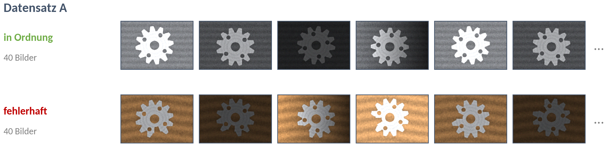
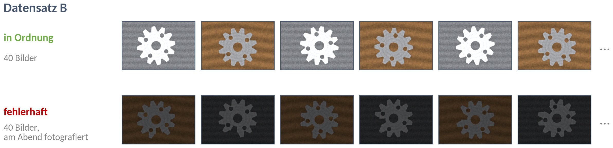
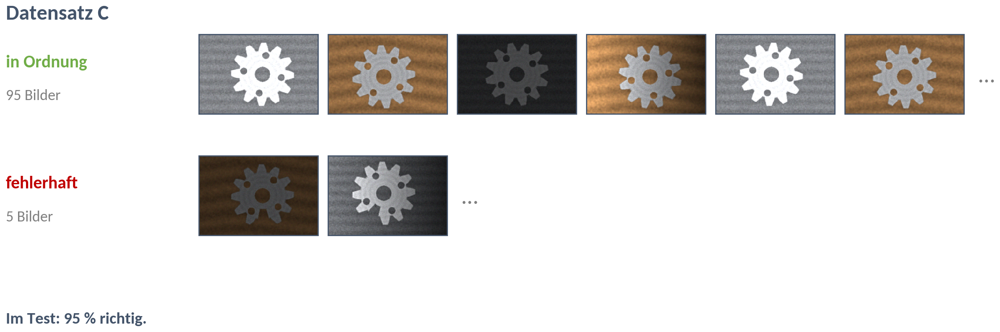
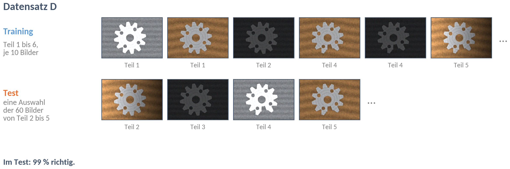

# DS 07 · Was ein Datensatz können muss

Partnerarbeit · Teil 1 9 Minuten, Antwort am Handy · Teil 2 13 Minuten

**Ziel:** Ihr erkennt, was ein Modell aus einem schlechten Datensatz wirklich lernt, und plant einen Datensatz für euer eigenes Bauteil, mit dem eine KI bei jedem Licht prüfen kann.

Alle Zahnräder auf diesem Blatt sind gerechnet. „Fehlerhaft“ heißt: Ein Zahn ist abgebrochen.

---

## Teil 1 · Datensatz-Detektiv

Jeder der Datensätze B, C und D hat **genau einen** Fehler. Datensatz A haben wir gemeinsam besprochen, er steht hier als Beispiel.

**Beispiel A:** Alle guten Zahnräder liegen auf dem Band, alle fehlerhaften auf Holz. Das Modell lernt den Untergrund: Holz heißt „fehlerhaft“.

**Auftrag 1:** *Was ist jeweils der Fehler im Datensatz? Schickt eure Antwort als Team über „Mitmachen“ am Handy ab, in die Felder „Datensatz B“, „Datensatz C“ und „Datensatz D“: je ein Stichwort oder ein kurzer Satz, höchstens 30 Zeichen.*

**Auftrag 2 (wer fertig ist):** *Überlegt, was das Modell aus diesem Datensatz stattdessen lernt und was man anders fotografieren müsste.*

---

## Teil 2 · Euer Aufnahmeplan

Bis zum 17.11. fotografiert ihr einen Datensatz von eurem Bauteil. Nächste Woche trainiert ihr damit euer erstes Modell und testet es bei jedem Licht.

**Auftrag 3:** *Plant euren Datensatz. Füllt dazu die Tabelle in eurem Heft oder in einer eigenen Datei aus.*

| Frage | Euer Plan |
|---|---|
| **Klassen:** Wie heißen eure zwei Klassen? | in Ordnung / fehlerhaft, oder: |
| **Richtlinie:** Ab wann ist ein Teil fehlerhaft? Drei Sätze, mit einem Grenzfall. | |
| **Teile:** Wie viele gute und wie viele fehlerhafte Teile habt ihr? | |
| **Licht:** Unter welchen Lichtern fotografiert ihr? | hell, dunkel, seitlich, misch, … |
| **Lage:** Was ändert ihr außerdem? (gedreht, verschoben, Abstand, …) | |
| **Untergrund:** Worauf liegt das Teil? Ist das in beiden Klassen gleich? | |
| **Anzahl:** Wie viele Bilder je Klasse und je Licht? | |
| **Test:** Welche Bilder kommen in den Test, und warum hat das Modell sie nie gesehen? | |
| **Abkürzung:** Welche Abkürzung könnte in eurem Plan stecken? | |

**Mindestens:** je Klasse 40 Trainingsbilder über alle vier Lichter, dazu je Klasse 10 Testbilder.

---

## Tipps

Tipp 1: Woran erkenne ich den Fehler in einem Datensatz?

Vergleicht nicht die Bilder **innerhalb** einer Zeile, sondern die beiden Zeilen **miteinander**. Was unterscheidet „in Ordnung“ von „fehlerhaft“ außer dem Zahn?

Tipp 2: Datensatz C sieht doch gut aus?

Stellt euch ein Modell vor, das sich die Bilder gar nicht ansieht und immer „in Ordnung“ sagt. Wie viel Prozent hat es im Test richtig?

Tipp 3: Datensatz D sieht doch gut aus?

Schaut auf die Teilenummern unter den Bildern. Welche Teile kennt das Modell schon aus dem Training?

Tipp 4: Wir haben kein fehlerhaftes Teil.

Macht einen Fehler, den man auf dem Foto sieht: Kerbe, Kratzer, abgebrochene Ecke, fehlende Schraube. Oder nehmt ein Teil aus der Reservekiste.

Tipp 5: Wir haben nur ein Teil je Klasse.

Dann könnt ihr nicht nach Teil trennen. Nehmt die Testbilder an einem anderen Tag und an einem anderen Ort auf und schreibt das in eure Richtlinie.

